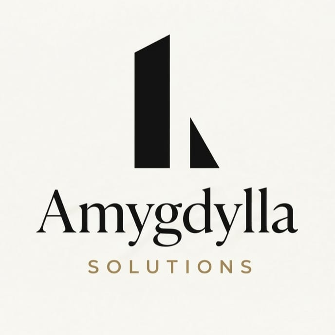

<!-- Replace with your logo (geometric mark + wordmark). Keep ~320px wide. -->

### Technology, shaped around you.

Your business is unique. Your technology should be too.

[**Website**](https://amygdylla.tech) &nbsp;·&nbsp; [**Email**](mailto:contact@amygdylla.tech) &nbsp;·&nbsp; [**LinkedIn**](https://www.linkedin.com/company/amygdylla) &nbsp;·&nbsp; [**Instagram**](https://www.instagram.com/amygdylla.solutions) &nbsp;·&nbsp; [**X**](https://x.com/amygdylla_HQ)

---

## What we do

Amygdylla Solutions engineers AI-driven automation, web infrastructure and custom software for businesses of every size, from large enterprises to small local firms. We start from how your business actually works, then build around it.

| | |
|---|---|
| **Websites** | Design, build and modernisation, with SEO, AEO and GEO so search engines and AI answer engines can find, understand and recommend you. Security and performance tuning included. |
| **Custom Software** | Internal tools, dashboards, portals and workflow systems, built to your process. Role-based access, clean architecture, documented handover. |
| **AI & Automation** | Deterministic and AI-driven automation for the work that eats your team's time. |

### Automation we build

- **Email intelligence:** reading, sorting, flagging, classifying and trust-scoring incoming mail
- **Document handling:** file conversion and formatting on cue
- **Always-on agents:** persistent agents with system-use capability for enterprise environments
- **Collection and follow-up systems:** automated reminders, tracking and certificate collection

## How an engagement works

1. **Consultation:** a free first conversation to understand the business
2. **Workflow exploration:** we map how work is done today and where it breaks
3. **Proposal:** a scoped service pitch with clear deliverables
4. **Confirmation:** agreed scope, timeline and terms
5. **Build:** iterative delivery with regular check-ins
6. **Handover or managed service:** you run it with clean code and documentation, or we keep it running for you (case by case)

## Case study: CSR workflow digitalisation

For the CSR department of a large enterprise, we are digitalising the full proposal-to-utilisation workflow: AI handling of incoming proposal emails (reading, sorting, flagging, classification, trust scoring), a role-based dashboard and login system, file conversion and formatting on cue, an always-on agent, and a utilisation-certificate collection system. The architecture is built for scaled use.

## Who we work with

- **Indian MSMEs:** CA firms, architects, clinics, gyms, schools and other local businesses
- **PSUs and large enterprises:** workflow and process digitalisation
- **Startups:** product modules built fast, cleanly and documented, with optional managed service
- **Foreign businesses:** the full service range, delivered remotely

## Engineering approach

We favour simple, maintainable architecture over clever architecture. Open-source agent frameworks and proven infrastructure are customised to the client's problem, which lets us adapt a solution to a new business quickly without starting from scratch. Security and responsible AI practices are part of the build, not an afterthought.

## Repositories

Public repositories will appear below as we open-source tooling and templates. Pinned repos are the best place to start.

## Get in touch

The first conversation is free. Availability varies with ongoing client work, so we keep a short waitlist when our engineers are fully booked.

**Email:** [contact@amygdylla.tech](mailto:contact@amygdylla.tech)

---

Amygdylla Solutions LLP · Sambalpur, Odisha, India

